# Route Scout

**Find where your future fans live, then plan the tour.**

Small bands and comedians usually guess where to tour, or default to big, expensive cities already packed with shows like theirs. Route Scout is an AI agent that tells an independent act:

1. **where people who love their kind of music actually live** (Qloo taste heatmap),
2. **which of those cities aren't already crowded** with similar ticketed shows (Ticketmaster),
3. **what a plain AI would have said instead**, so the difference is visible,

and then plans a drivable tour, with the crowd, venues and support acts for every stop.

> Built for the **Qloo Agentic Hackathon 2026**.

## Walkthrough

> Screenshots use the bundled **sample** demo (no API keys). Live runs look the same with real Qloo and Ticketmaster data.

**1. The Stage.** One question, one input. Name the artists you sound like, or tap "Try a demo artist".

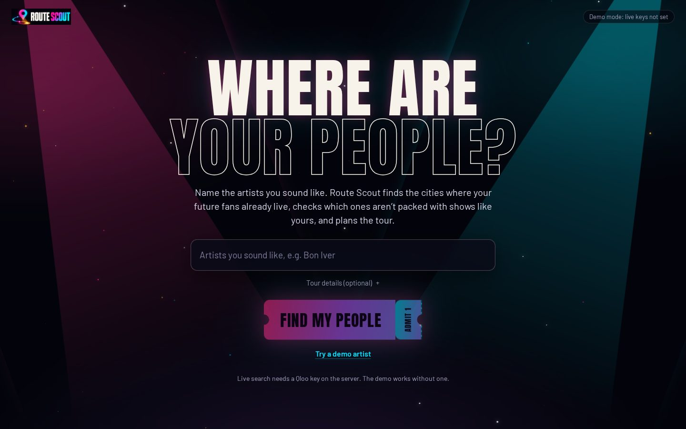

**2. Add your artists.** Names become chips (with photos from Qloo when live). Tour details are optional: act name for the poster, home city, number of shows, first date, your sound.

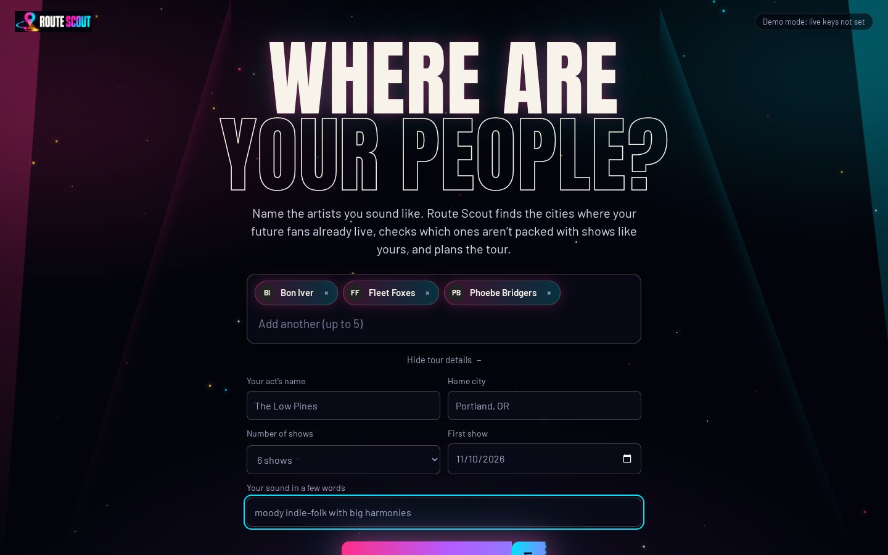

**3. Soundcheck.** The agent works in the open. Each tool call streams into the checklist while the globe lights up with real taste cells.

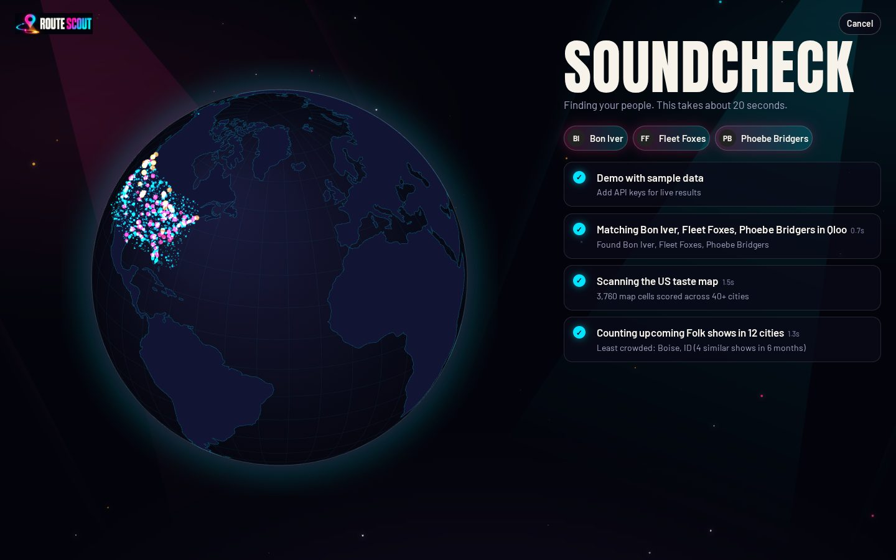

**4. The reveal, part one.** First, what a plain AI (no data) suggests: the obvious cities.

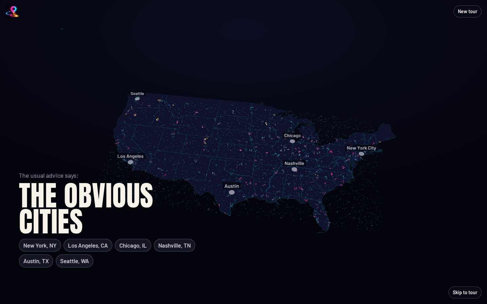

**5. Lights down.** Light pillars rise from thousands of Qloo heatmap cells. Height and colour show how strongly people there share your taste.

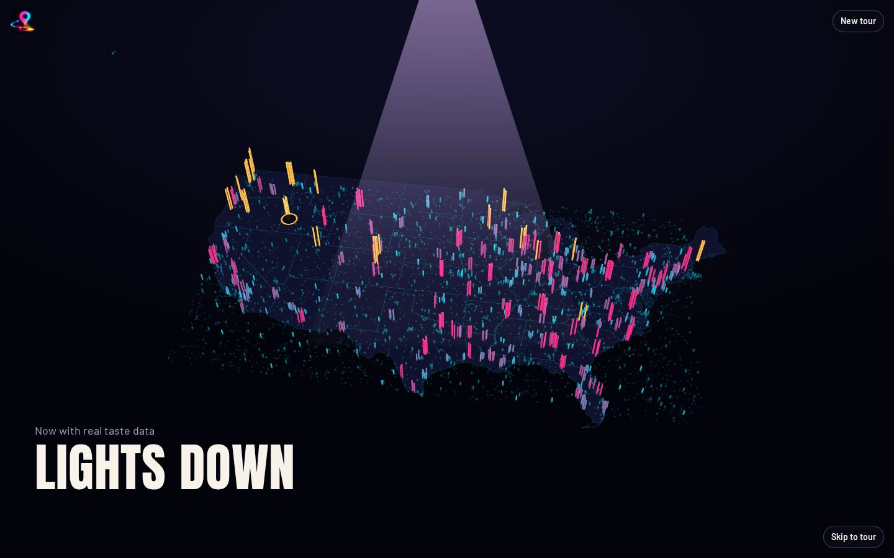

**6. Your hidden city.** Spotlights land on the best city the plain AI missed, with the evidence: taste rank, ticketed shows already booked, and the plain AI's list.

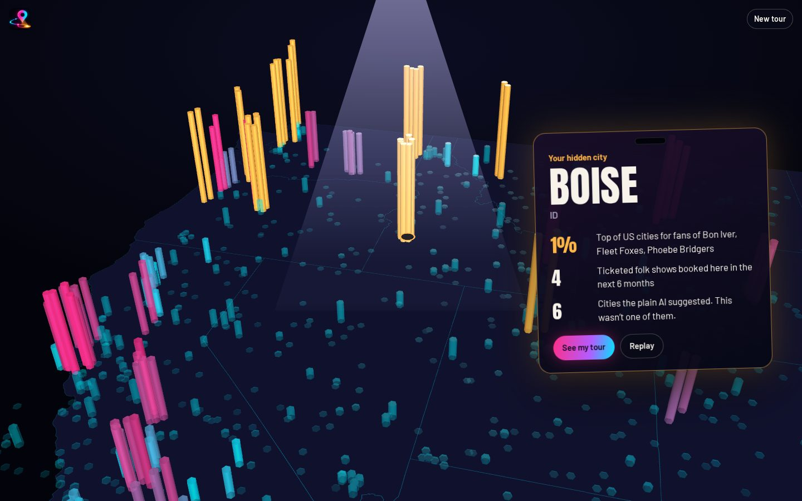

**7. The tour.** A drivable route with dates and travel time. Drag or use the arrows to reorder, swap any city for the next best one, and replay the reveal.


**8. Compare.** Toggle "Plain AI picks" to see the generic answer on the same map.

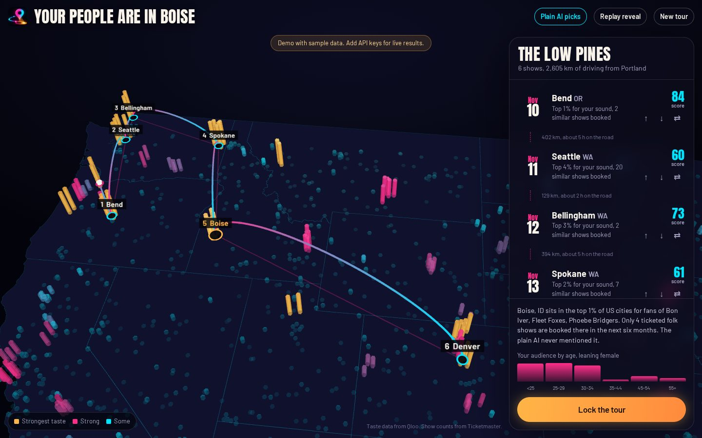

**9. Backstage Pass.** Tap any stop: who the crowd is (taste, brands, hangouts), and how much room there is to grow.

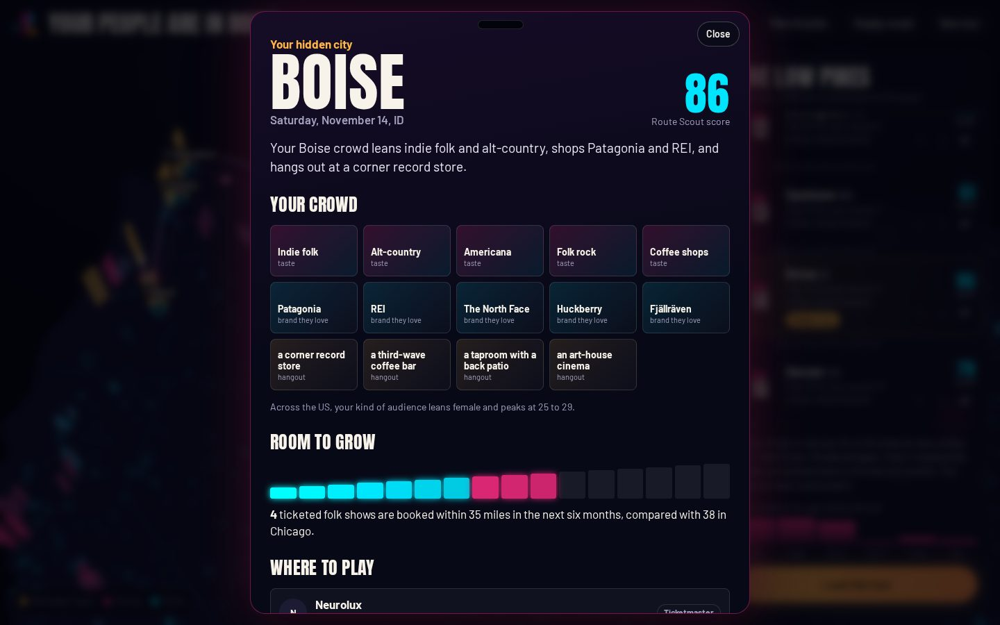

**10. Where to play and who with.** Real venues with upcoming shows, local support acts (with "Rising" badges from Qloo trends) and the score breakdown.

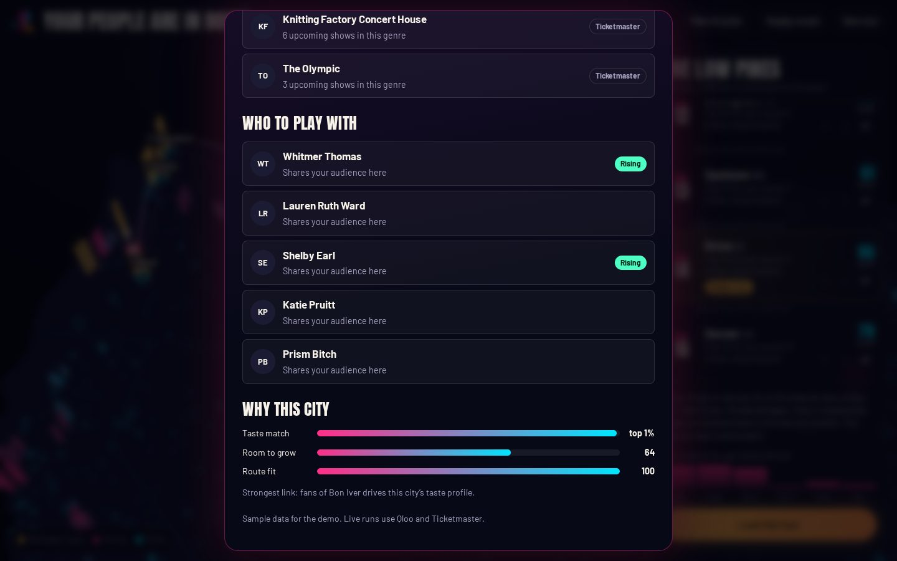

**11. Lock the tour.** The encore: disco ball, confetti, a downloadable poster and a share link.

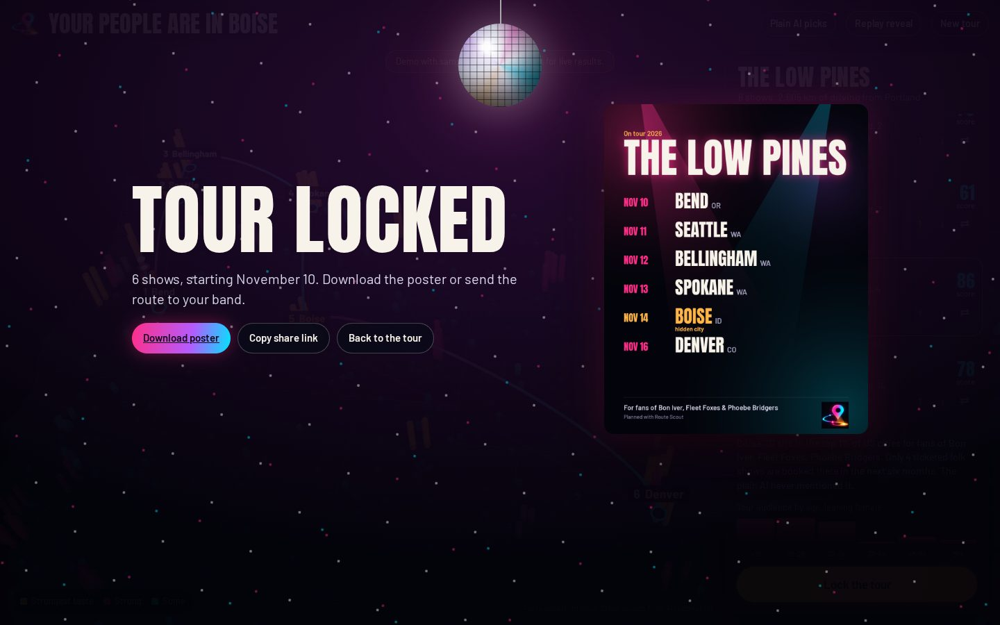

**12. The poster** the app generates:

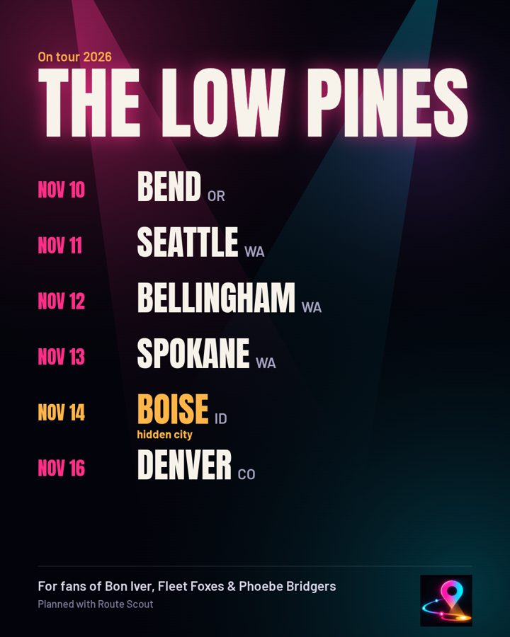

**13. On a phone.** Same flow, with the setlist as a bottom sheet.

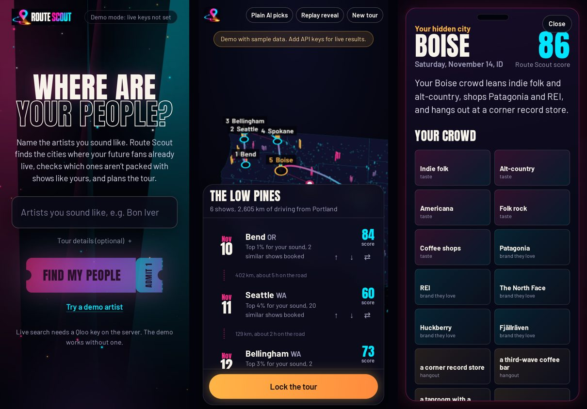

### What `./start.sh` prints on a first run

```text
ROUTE SCOUT
Find where your people are.

▸ Node v22.x
▸ Installing dependencies (first run takes a minute)…
▸ Created .env.local from .env.example
▸ Let's add your API keys. They stay on this computer in .env.local (never committed).
Qloo API key (required for live results): ••••
Ticketmaster key (developer.ticketmaster.com) (press Enter to skip): ••••
OpenRouter key (openrouter.ai/keys) (press Enter to skip): ••••
▸ Checking your keys…
✅ Qloo         found Bon Iver
✅ Ticketmaster 1,234 music events listed in Chicago
✅ OpenRouter   openai/gpt-4o-mini says "ready"
▸ Starting Route Scout at http://localhost:3000  (Ctrl+C to stop)
```
(Your numbers and model will differ.)

## Why it needs Qloo

A plain language model answers "where should an indie-folk act tour?" with New York, LA and Chicago. Route Scout asks Qloo instead:

| Feature | Qloo call |
|---|---|
| Match "artists you sound like" | `GET /search` (artist) |
| **Hidden City heatmap**: ~9,700 taste cells across the US, grouped into cities by Route Scout | `GET /v2/insights` `filter.type=urn:heatmap`, US polygon |
| Genre for the show-competition check | `urn:tag` insights filtered to music genres, `/v2/analysis/compare` fallback |
| Support acts who share your audience *in that city* | `urn:entity:artist` + `signal.location.query` + `filter.popularity.max` + explainability |
| "Rising" badge | `GET /v2/trending` |
| Crowd portrait: brands, taste tags, hangouts | `urn:entity:brand`, `urn:tag`, `urn:entity:place` with location |
| Live-music venues | `urn:entity:place` + `urn:tag:genre:place:live_music_venue` |
| Audience age and gender | `urn:demographics` |
| "Why this pick" evidence | `feature.explainability=true` |

Without Qloo there is no heatmap, no hidden city and no crowd, so the product does not exist.

## How the agent works

`lib/agent.ts` runs an OpenRouter tool-calling loop. The model decides the order and arguments of seven tools:

`resolve_artists` → `scan_taste_map` → `check_room_to_grow` → `check_similar_artist_tours` → `ask_plain_ai` → `plan_tour` → `finish`

- A **coverage check** guarantees every plan has taste, show competition, the plain-AI baseline and a route, even if the model skips a step.
- **Facts come from tools, not the model.** The summary is assembled from tool results, so every number is real. The model's headline is used only if it names the final hidden city and contains no numbers.
- With no OpenRouter key, the same tools run on **autopilot**.
- Every step streams to the browser (Server-Sent Events) and appears in the Soundcheck checklist.

**Score per city (0-100):** 60% taste (Qloo affinity, normalised across the top candidates) + 40% room to grow (similar ticketed shows per 100k people, from Ticketmaster), minus a little if similar artists already have dates there. Stops are then picked for route fit, ordered nearest-neighbour + 2-opt, and dated with travel days.

**Copy rule:** the UI says "top 2% of cities", never "3x more likely", because Qloo returns ranks, not ratios.

## Run it locally

Requires Node 18.18+.

**Quickest (Mac/Linux):**

```bash
./start.sh            # first run: installs, asks for your keys, checks them, opens the app
./start.sh keys       # change your keys later
./start.sh prod       # production build + start
./start.sh snapshot   # record a live run for the demo button
```

If macOS says permission denied, run `chmod +x start.sh` once.

**Or step by step:**

```bash
npm install
cp .env.example .env.local     # then paste your keys
npm run check:keys             # confirms each key works
npm run test:qloo              # optional: deeper check of every Qloo feature the app uses
npm run dev                    # http://localhost:3000
```

| Variable | Needed for |
|---|---|
| `QLOO_API_KEY`, `QLOO_BASE_URL` | Everything live (required) |
| `TICKETMASTER_API_KEY` | Show counts, similar-artist dates, venues (free at developer.ticketmaster.com) |
| `OPENROUTER_API_KEY`, `OPENROUTER_MODEL` | The AI agent, plain-AI baseline, crowd sentence. Pick any current model that supports tools at openrouter.ai/models |
| `UPSTASH_REDIS_REST_URL/TOKEN` | Optional shared cache across serverless instances |

Keys are only read on the server. Never commit `.env.local`.

## Demo mode

"Try a demo artist" works with no keys. The bundled demo uses **clearly labelled sample data**. Once your keys work, record a real run so judges always get instant, real results:

```bash
npm run snapshot               # or: npm run snapshot -- "Artist A" "Artist B"
```

This overwrites `data/demo/*.json`. Commit and redeploy. (`npm run sample` regenerates the sample data.)

## Analytics

Route Scout uses **Microsoft Clarity** (free) for session recordings and heatmaps, so you can see whether judges actually used the app. It never loads on `localhost`, so your own testing stays out of the data.

Key moments are marked as Clarity custom events: `demo_started`, `tour_started`, `tour_ready` (tagged with `hidden_city`), `tour_failed`, `city_opened`, `tour_locked`, `poster_downloaded`, `share_link_copied`. In Clarity, open **Recordings → Filters → Custom events** and pick `tour_ready` to watch only visits that reached a full tour. Recordings don't capture the 3D map canvas, but they do show every screen, card and click.

Set `NEXT_PUBLIC_CLARITY_ID` to use a different Clarity project, or `off` to disable it.

**Presenting live?** Add `?slowmo=2` to the URL to slow the reveal down.

## Deploy (Vercel)

1. Push this folder to a **public** GitHub repo.
2. Import it at vercel.com/new (framework: Next.js, no build settings needed).
3. Add the environment variables from `.env.example` (set `NEXT_PUBLIC_SITE_URL` to your Vercel URL).
4. Deploy, then run `npm run snapshot` locally and push to refresh the demo with live data.

API routes stream for up to 60 s (`maxDuration`), which a typical run (~20-30 s) fits.

## Project map

```
app/                 page, layout, API routes (agent stream, city detail, artist search, health)
components/          UI: Landing, Soundcheck + Globe, MapStage (reveal + tour), TourMap (deck.gl),
                     BackstagePass, Encore (poster + share), StageLights
lib/agent.ts         the agent: tools, coverage check, scoring, narrative guardrails
lib/qloo.ts          Qloo client (cache, retries)
lib/ticketmaster.ts  Ticketmaster Discovery client (throttled to stay under 5 req/s)
lib/geo.ts           heat-cell → city grouping, route ordering, geohash
data/us-cities.json  297 US metro anchors (GeoNames)
scripts/             check-keys, snapshot (record live demo), make-sample, qloo-day1-test
docs/screenshots/    walkthrough images used in this README
start.sh             one-command setup and start
```

## Honest limits

- Qloo affinity is a taste model, not a ticket-sales forecast.
- Ticketmaster mostly lists ticketed shows; small DIY gigs are under-counted, so the app says "ticketed shows".
- Qloo's city-level heatmap output returned server errors in testing, so Route Scout groups geohash cells into cities itself.
- US only for now.

## Credits

- Taste data: [Qloo](https://www.qloo.com) Taste AI. Show data: [Ticketmaster Discovery API](https://developer.ticketmaster.com).
- City list derived from [GeoNames](https://www.geonames.org) (CC BY 4.0) via `all-the-cities`.
- Map shapes: `us-atlas` and `world-atlas` (US Census Bureau and Natural Earth, ISC licence).
- Fonts: Anton and Barlow (SIL Open Font License) via Fontsource.

## License

MIT, see [LICENSE](LICENSE).
